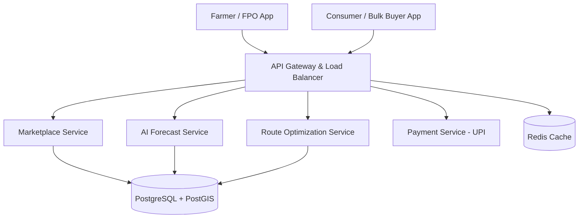

# Smart India Hackathon Workshop

## Date:29.10.2026

## Register Number:26016808

## Name:K R Sarvesh

## Problem Title

SIH 26033: Multiple intermediaries reduce farmer's earnings and increase consumer prices

## Problem Description

Background: Agricultural produce passes through many intermediaries (commission agents, wholesalers, retailers) before reaching the consumer. Each layer adds a margin, so farmers receive a small share of the final price while consumers pay more.

Expected Solution: Create a digital marketplace that:
- Connects farmers/FPOs directly with consumers and bulk buyers.
- Provides logistics support.
- Uses AI for demand forecasting and route optimization.

Benefits: Better prices for farmers, lower prices for consumers, reduced supply chain inefficiencies.

## Problem Creator's Organization

Ministry of Consumer Affairs, Food & Public Distribution

## Theme

Agriculture, FoodTech & Rural Development

## Idea

**Farm2Table: AI-powered direct farm-to-buyer marketplace.**
Farmers and FPOs list produce in their own language, buyers order directly, and the platform handles pricing, pickup and delivery. AI forecasts demand and prices so farmers know what to grow and when to sell, and route optimization cuts delivery cost.

## Proposed Solution / Architecture Diagram

1. **Listing Phase:** Farmers/FPOs add produce (crop, quantity, grade, price) through a mobile app, with voice and regional-language support.
2. **Matching Phase:** Consumers and bulk buyers (restaurants, retailers, institutions) browse and order directly. A price breakdown shows what the farmer earns versus the mandi price.
3. **Intelligence Phase:** AI forecasts demand and suggests fair prices using historical mandi data.
4. **Logistics Phase:** Orders are grouped by area, and the optimized pickup and delivery route is assigned to a transport partner.

## Use Cases

**1. Direct Sale to Bulk Buyers:**
An FPO lists 2 tonnes of tomatoes. A restaurant chain orders directly at an agreed price, with no mandi or agent commission.

**2. AI Price and Demand Guidance:**
Before listing, the farmer sees the predicted price and demand for the coming week and decides the best time to sell, reducing wastage and distress sales.

**3. Optimized Pickup and Delivery:**
Orders from nearby farms are combined into one route, lowering transport cost and delivery time.

## Technology Stack

**1. Mobile and Web Application**
Technologies: Flutter (Dart) or React Native, React (web)
Purpose: Farmer and buyer interfaces with regional-language and voice support.

**2. Backend and APIs**
Technologies: Python (FastAPI) or Node.js (Express), PostgreSQL, PostGIS, Redis
Purpose: Handles users, listings, orders, locations and caching.

**3. AI / ML**
Technologies: Python, Prophet / XGBoost, scikit-learn
Purpose: Demand and price forecasting from historical mandi price data.

**4. Route Optimization**
Technologies: Google OR-Tools, OpenStreetMap / Leaflet
Purpose: Plans efficient pickup and delivery routes and displays them on a map.

**5. Payments**
Technologies: UPI, Razorpay
Purpose: Secure, direct payments to farmers.

**6. Notifications**
Technologies: Firebase Cloud Messaging, SMS / WhatsApp API
Purpose: Order updates and price alerts, including for farmers without smartphones.

## Dependencies

**Data Sources:**
Agmarknet and eNAM mandi price data for model training and price comparison.

**Partners / Infrastructure:**
FPOs for farmer onboarding, local transport partners, and collection hubs for aggregation.

**APIs & SDKs:**
Maps/Routing API, payment gateway SDK, speech-to-text and text-to-speech for voice support, location permissions for pickup and delivery.
