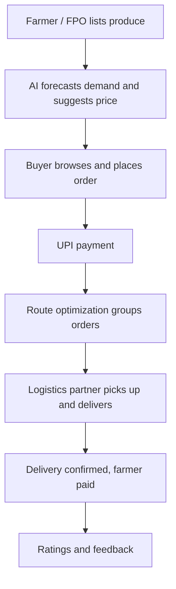

# Smart India Hackathon Workshop

## Date:29.10.2026

## Reference Number:26016808

## Name: K R Sarvesh

## Problem Title

SIH 26033: Multiple intermediaries reduce farmers' earnings and increase consumer prices

## Problem Creator's Organization

Ministry of Consumer Affairs, Food & Public Distribution

## Problem Description

**Background:** Agricultural produce in India usually passes through several intermediaries (commission agents, wholesalers, mandi traders, retailers) before it reaches the consumer. Each layer adds its own margin, so farmers receive only a small share of the final price while consumers pay much more. Small and marginal farmers also lack market information, storage and transport, so they often sell at distress prices right after harvest.

**Key Challenges:**
- Farmers have little visibility into real-time demand and fair prices.
- Many layers of intermediaries inflate consumer prices.
- Poor logistics and cold storage lead to post-harvest losses.
- Small farmers cannot reach bulk buyers on their own.
- Low digital literacy and language barriers limit the use of technology.

**Expected Solution:** A digital marketplace that:
- Connects farmers/FPOs directly with consumers and bulk buyers.
- Provides logistics support.
- Uses AI for demand forecasting and route optimization.

**Benefits:** Better prices for farmers, lower prices for consumers, reduced supply chain inefficiencies.

## Proposed Solution

**Farm2Table: an AI-powered direct farm-to-buyer marketplace.**

1. **Detailed explanation of the proposed solution:**
   Farmers and FPOs list produce (crop, quantity, grade, price) through a mobile app with voice and regional-language support. Consumers and bulk buyers (restaurants, retailers, institutions) browse and order directly. The platform handles payments through UPI and arranges pickup and delivery with local transport partners.

2. **How it addresses the problem:**
   - Direct farmer-to-buyer sales remove the intermediary layers, so farmers earn more and consumers pay less.
   - A transparent price breakdown shows what the farmer receives versus the mandi price.
   - AI demand and price forecasts help farmers decide what to sell and when.
   - Route optimization and pooled transport reduce logistics cost and spoilage.

3. **Innovation and uniqueness of the solution:**
   - AI-based demand and price forecasting built on public mandi data.
   - Voice-first, regional-language interface, with SMS/WhatsApp fallback for farmers without smartphones.
   - FPO dashboard to aggregate small farmers' produce for bulk orders.
   - "Fair-price score" showing how much of the consumer's rupee reaches the farmer.

## Technical Approach

**1. Technologies to be used:**

| Layer | Technologies |
|---|---|
| Mobile / Web | Flutter or React Native, React |
| Backend | Python (FastAPI) or Node.js (Express) |
| Database | PostgreSQL + PostGIS, Redis |
| AI / ML | Python, Prophet / XGBoost, scikit-learn |
| Route optimization | Google OR-Tools, OpenStreetMap / Leaflet |
| Payments | UPI, Razorpay |
| Notifications | Firebase Cloud Messaging, SMS / WhatsApp API |
| Hosting | AWS / GCP, or free tiers (Vercel, Render) for the prototype |

**2. Methodology and process for implementation:**

Implementation steps:
1. Build the farmer and buyer screens (listing, browsing, ordering).
2. Build the backend APIs for users, listings, orders and payments.
3. Train the price/demand forecasting model on Agmarknet data and expose it as an API.
4. Add route optimization with OR-Tools and display routes on a map.
5. Pilot in one district with a few crops, then expand.

## Feasibility and Viability

**Feasibility:**
- All components use mature technology: smartphones, GPS, UPI, cloud hosting and open-source ML libraries.
- Public mandi price data (Agmarknet, eNAM) is available for training.
- FPOs already aggregate farmers, which makes onboarding easier.
- A prototype can start in one district with a few crops such as tomato, onion and potato.

**Viability:**
- Small commission or delivery fee per order, far lower than traditional intermediary margins.
- Subscription plans for bulk buyers.
- Optional premium AI insights for FPOs.

**Potential challenges and risks, and strategies to overcome them:**

| Challenge | Strategy |
|---|---|
| Low digital literacy among farmers | Voice-based regional-language app; onboarding through FPOs and local agents |
| Last-mile delivery and cold-chain cost | Local collection hubs, route optimization, pooled transport |
| Quality and trust issues | Grading standards, ratings, photo verification |
| Poor rural connectivity | Lightweight app, offline mode, SMS/WhatsApp fallback |
| Cold start (buyers vs. farmers) | Start with FPOs and institutional buyers, then expand |
| Payment delays | UPI-based instant payment and escrow |

## Impact and Benefits

**Potential impact on the target audience:**
Small and marginal farmers, FPOs, urban and rural consumers, bulk buyers and local transport providers gain direct market access, fair pricing and transparency.

**Benefits of the solution:**
- **Social:** better rural livelihoods, market access for small farmers, local jobs in logistics and aggregation.
- **Economic:** higher farmer margins, lower consumer prices, lower transport and transaction costs.
- **Environmental:** less food waste through demand forecasting, lower fuel use through optimized and pooled routes.
- **Policy alignment:** supports eNAM, FPO promotion and Digital India.

## Research and References

1. Agmarknet (Agricultural Marketing Information Network): mandi price and arrival data
2. eNAM (National Agriculture Market): online trading platform
3. Ministry of Consumer Affairs, Food & Public Distribution: price monitoring reports
4. NABARD and Government of India resources on Farmer Producer Organisations (FPOs)
5. Existing platforms studied for comparison: AgroStar, DeHaat, Kisan Network
6. Google OR-Tools documentation: vehicle routing
7. Prophet / XGBoost documentation: time-series forecasting
